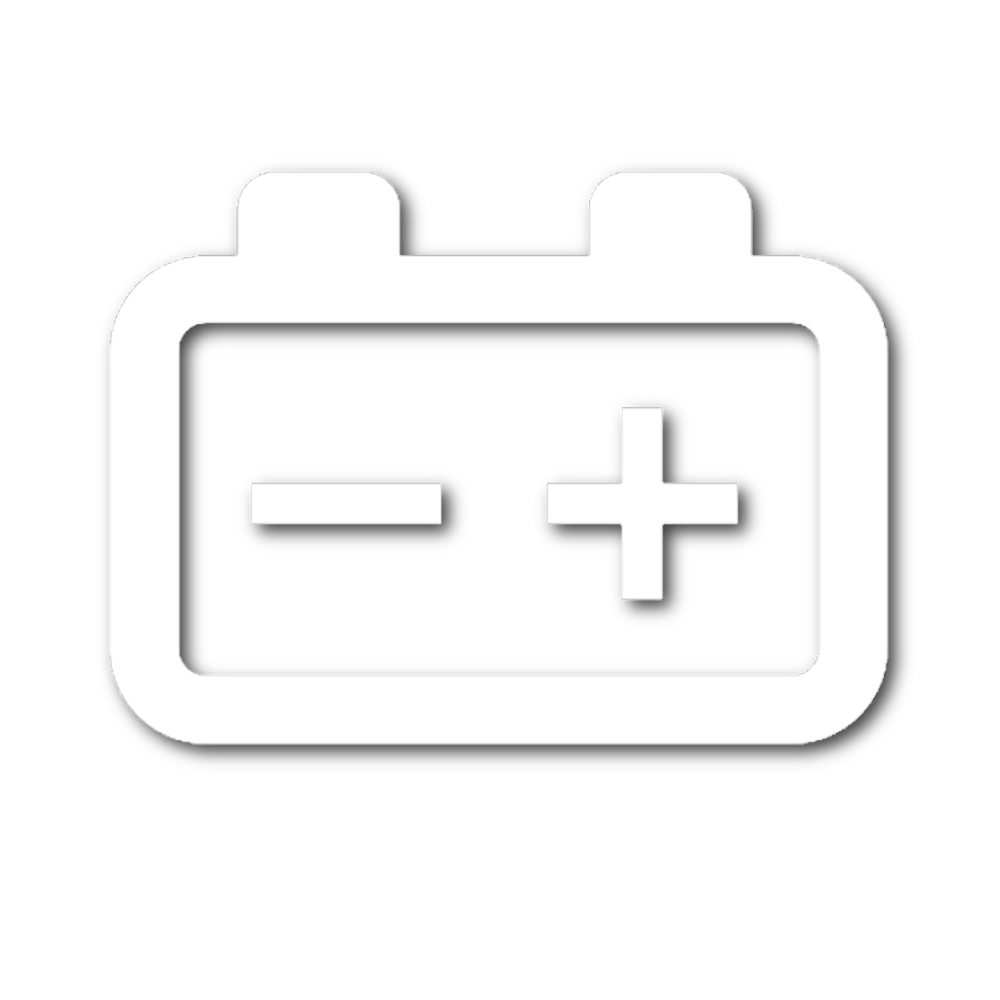
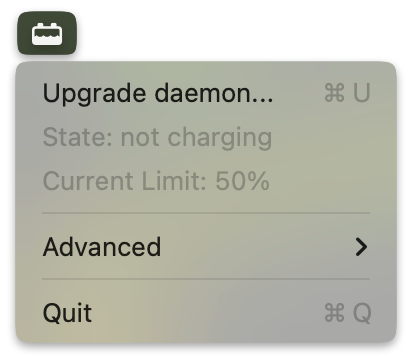
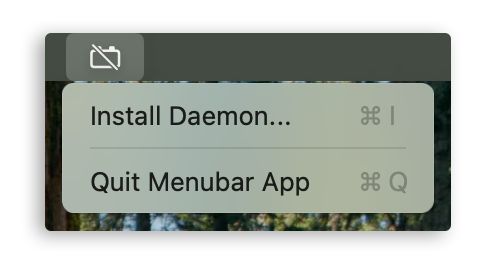

> [!NOTE]
> **Feb 17, 2026 UPDATE:** <br>
> Finally, after more than 5 years, macOS 26.4 and later supports charge limiting natively (adjustable from 80% to 100%), so ***`batt` is not needed if the built-in range meets your needs***. `batt` remains useful on older releases and when you want a limit below 80%. On macOS 27-era firmware, `batt` programs the firmware's charge-limit facility directly.



# Batt

[](https://github.com/charlie0129/batt/actions/workflows/gochecks.yml)
[](https://github.com/charlie0129/batt/actions/workflows/build-test-binary.yml)


<span style="font-size: 20px;">`batt` is a tool to control battery charging on Apple Silicon MacBooks.</span>

<span style="font-size: 19px;">Full docs [here!](SITELINK_FOR_DOCS_HERE_THIS_IS_A_PLACEHOLDER)</span>



## Why do you need this?

[This article](https://batteryuniversity.com/article/bu-808-how-to-prolong-lithium-based-batteries) might be helpful. 

> [!NOTE]
> **TL;DR** <br>
> keep your battery at 80% or lower when plugged in, and discharge it as shallowly as feasible.

Previously, before optimized battery charging was introduced, MacBooks are known to suffer from battery swelling when they are kept at 100% all the time, especially the 2015s. Even with optimized battery charging, the effect is not optimal <span style="font-size: 13px;">(described [here](docs/comparison.md#but-macos-has-similar-features-built-in-is-it))</span>

`batt` can effectively alleviate this problem by limiting the battery charge level. It can be used to set a maximum charge level. For example, you can set it to 80%, and it will stop charging when the battery reaches 80%.

On older firmware, the computer then runs from wall power and the battery percentage remains steady. On macOS 27-era firmware, Apple changed the mechanism: the firmware may run the Mac from the battery when it is above the limit, so the percentage can drop until it returns to the configured range.

### Guides

[](docs/installation.md)
[](docs/compatibility.md)
[](docs/usage.md)
[](docs/building.md)

### Other

[](docs/faq.md)
[](docs/comparison.md)

### Links

[](https://github.com/charlie0129/batt/releases/latest)
[](https://formulae.brew.sh/formula/batt#default)
[](https://github.com/charlie0129/batt)

## Features

`batt` tries to keep things as simple as possible. Charge limiting is the only thing to care about for most users:

- Limit battery charge, with a lower and upper bound, like ThinkPads. [Docs](docs/usage.md#limit-battery-charge)
- Charge to the limit or to 100% once, without changing the limit. [Docs](docs/usage.md#charge-once)

However, if you are nerdy and want to dive into the details, it does have some advanced features for power users. These are shown only when the current Mac's SMC keys support them.

- Control MagSafe LED (if present) according to charge status. [Docs](docs/usage.md#control-magsafe-led)
- Cut power from the wall (even if the adapter is physically plugged in) to use battery power. [Docs](docs/usage.md#enabledisable-power-adapter)
- On firmware < `20xxx`, it solves common sleep-related issues when controlling charging. [Docs1](docs/usage.md#preventing-idle-sleep) [Docs2](docs/usage.md#disabling-charging-before-sleep)
- Calibrate battery automatically. [Docs](docs/usage.md#auto-calibration-experimental)

## Installation

> [!NOTE]
> This is a quick and short overview,

[](docs/installation.md)

### Installing the GUI

> [!TIP]
> It is _highly_ recommended to disable macOS's optimized charging when using `batt`. <br>
> To do so, open `System Settings` -> `Battery` -> `Battery Health` -> `i` -> Turn OFF `Optimized Battery Charging`. <br>
> Built-in charge limit also needs to be disabled if you are on macOS 26.4 or later.

* Download `.dmg` file from [Releases](https://github.com/charlie0129/batt/releases) and open it (right-click open if macOS says it's damaged)
* Drag `batt.app` to `Applications`
* macOS may say it's damaged when you try to run it. To fix it, run this in your Terminal: <br>
`sudo xattr -r -d com.apple.quarantine /Applications/batt.app`.
* Run `batt.app` and follow the MenuBar UI to install or upgrade.



### Installing the CLI

#### Homebrew

```bash
  brew install batt
  sudo brew services start batt
```

#### Installation Script

```bash
  curl -fsSL https://github.com/charlie0129/batt/raw/master/hack/install.sh
```

After installation run the following command to ensure that the installation succeeded:

```bash
batt help
```

## Compatibility

> [!NOTE]
> This is a quick and short overview,

[](docs/compatibility.md)

| macOS Version | GUI | CLI (Prebuilt) | CLI (Build from Source) |
| --- | --- | --- | --- |
| macOS 11 Big Sur | ❌ | ❌ | ⚠️ |
| macOS 12 Monterey | ❌ | ⚠️ | ✅ |
| macOS 13 Ventura | ⚠️ | ⚠️ | ✅ |
| macOS 14 Sonoma | ⚠️ | ⚠️ | ✅ |
| macOS 15 Sequoia | ✅ | ✅ | ✅ |
| macOS 26 Tahoe | ✅ | ✅ | ✅ |
| macOS 27 Golden Gate Beta 1–3 | ✅ | ✅ | ✅ |
| macOS 27 Golden Gate Beta 4+ | ✅ | ✅ | ✅ |
| Other | ❓ | ❓ | ❓ |

- ✅ Supported
- ⚠️ Not verified, but expected to work
- ❌ Unsupported
- ❓ Unknown

### Special Notes

- macOS 27 Beta 1–3: Firmware-managed charge limits. Limits remain active during sleep.
- macOS 27 Beta 4+: Requires adapter mode for custom charge limits, including limits below 80%.

### Adapter Mode

Enable with:

```bash
sudo batt adapter-mode enable
```

- Supports charge limits from 10% to 100%.
- Works only while `batt` is awake.
- Disables Force Discharge and auto-calibration.
- Native macOS charge limits remain available at 80% and above.

For release compatibility, see the [release page](https://github.com/charlie0129/batt/releases).

## Usage

[](docs/usage.md)

## Building

> [!NOTE]
> This is a quick and short overview,

[](docs/building.md)

### Building the CLI

```bash
make
```

### Building the GUI

```bash
make app
```

## Architecture

You can think of `batt` like `docker`. It has a daemon that runs in the background, and a client (CLI or GUI) that communicates with the daemon. They communicate through unix domain socket as a way of IPC. The daemon does the actual heavy-lifting, and is responsible for controlling battery charging. The client is responsible for sending users' requirements to the daemon.

For example, when you run `sudo batt limit 80`, the client will send the requirement to the daemon, and the daemon will do its job to keep the charge limit to 80%.

The daemon selects one of two control backends from SMC key presence. The legacy backend continuously reads battery percentage and toggles charging itself. The firmware backend writes lower/upper limits and periodically reconciles them while Apple firmware enforces the range, including during sleep. The same capability data is exposed to CLI and GUI clients so unsupported features are not offered.

## Motivation

I created this tool simply because I am not satisfied with existing tools 😐.

I have written and used similar utils (to limit charging) on Intel MacBooks for years. Finally I got hands on an Apple Silicon MacBook (yes, 2 years after it was introduced 😅 and I just got my first one). The old BCLM way to limit charging doesn't work anymore. I was looking for a tool to limit charging on M1 MacBooks.

I have tried some alternatives, both closed source and open source, but I kept none of them. Some paid alternatives' licensing options are just too limited 🤔, a bit bloated, require periodic Internet connection (hmm?) and are closed source. It doesn't seem a good option for me. Some open source alternatives just don't handle edge cases well and I encountered issues regularly especially when sleeping (as of Apr 2023).

I want a _simple_ tool that does just one thing, and **does it well** -- limiting charging, just like the [Unix philosophy](https://en.wikipedia.org/wiki/Unix_philosophy). It seems I don't have any options but to develop it myself. So I spent a weekend developing an MVP, so here we are! `batt` is here!

## Acknowledgements

- [actuallymentor/battery](https://github.com/actuallymentor/battery) for various SMC keys.
- [hholtmann/smcFanControl](https://github.com/hholtmann/smcFanControl) for its C code to read/write SMC, which inspires [charlie0129/gosmc](https://github.com/charlie0129/gosmc).
- [Apple](https://developer.apple.com/library/archive/qa/qa1340/_index.html) for its guide to register and unregister sleep and wake notifications.
- [@exidler](https://github.com/exidler) for building the MagSafe LED controlling logic.
- [@pichxyaponn](https://github.com/pichxyaponn) for the initial version of GUI.
- [@MabaKalox](https://github.com/MabaKalox) for prevent-system-sleep feature.
- [@peterneutron](https://github.com/peterneutron) for refactoring the power metrics code and the power flow feature.
- [@invisiblepixel](https://github.com/invisiblepixel) for app icon design.
- [@brookqin](https://github.com/brookqin) for implementing auto calibration.
- [@ashwinr64](https://github.com/ashwinr64) for investigating SMC keys on macOS 27 [#140 comment](https://github.com/charlie0129/batt/pull/140#issuecomment-4950731214) [actuallymentor/battery#469](https://github.com/actuallymentor/battery/pull/469), also [@lilianmoraru](https://github.com/lilianmoraru) for the initial PR.

## Star History

[](https://star-history.dera.page/#charlie0129/batt&Date)
